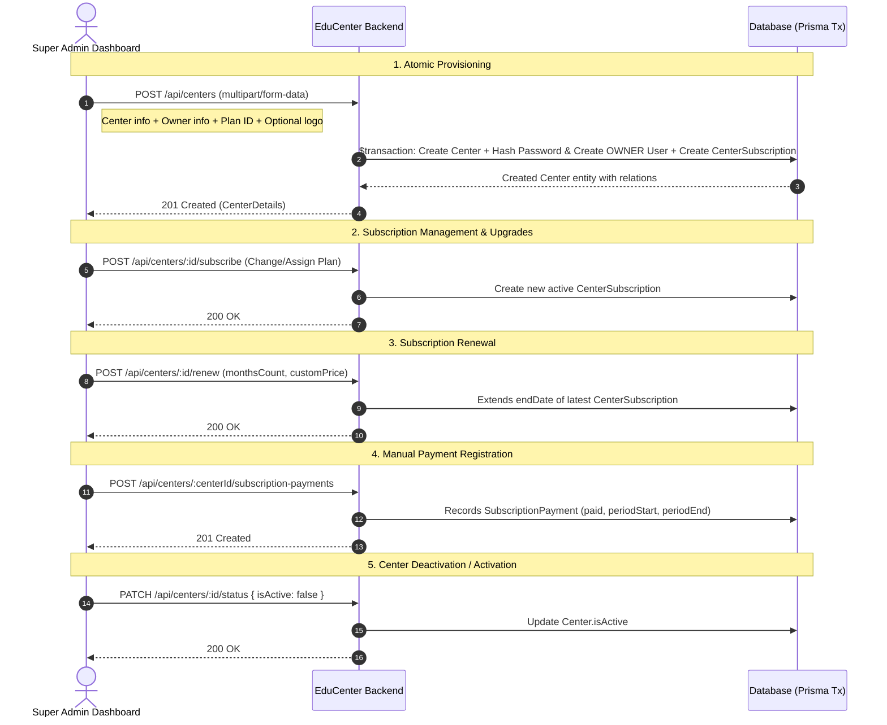

# Super Admin API & Business Flow Guide

> **Target Audience:** Frontend engineers and AI agents building the **Super Admin Dashboard**.
> This document details the exact, real implementation of the backend APIs, authentication lifecycle, and business flows for platform-level management.

---

## 1. System Overview & Super Admin Role

**EduCenter** is a multi-tenant SaaS educational management platform designed for learning centers and academies.

### Role Hierarchy & Scope
- **`SUPER_ADMIN`**: The platform owner/administrator.
  - Independent account stored in the `SuperAdmin` database table (`centerId: null`).
  - Full authority over global platform operations: creating subscription plans, provisioning centers with their owners and initial subscriptions, managing center activation/deactivation, assigning/renewing subscriptions, and tracking global subscription revenue.
- **`OWNER`**: An educational center owner.
  - Stored in the `User` table (`role: OWNER`, linked to a specific `centerId`).
  - Manages internal operations within their center: teachers, students, groups, internal payments, and staff users via `/api/users`.
- **`TEACHER` / `STUDENT`**: Center tenant users scoped strictly to their assigned classes, groups, and records.

---

## 2. Authentication Flow

The platform separates platform admin authentication from center user authentication.

```text
Super Admin (Credentials)
        │
        ▼
POST /api/auth/super-admin/login
        │
        ▼
Returns: { accessToken: string, user: { id, fullName, email, role: "SUPER_ADMIN", centerId: null } }
        │
        ▼
Store accessToken (e.g., localStorage / secure cookie)
        │
        ▼
Attach to all protected requests:
Header: Authorization: Bearer <accessToken>
```

### Key Auth Rules:
1. **Endpoint Distinction:**
   - Super Admin **MUST** log in via `POST /api/auth/super-admin/login`.
   - Center accounts (`OWNER`, `TEACHER`, `STUDENT`) log in via `POST /api/auth/login`.
2. **Payload Structure:**
   - JWT Payload contains: `{ sub: user.id, role: user.role, centerId: user.centerId }`.
3. **Real-Time Active Check:**
   - Every request validated by `JwtAuthGuard` executes a real-time check against the database (`superAdmin.isActive === true`). If deactivated, it immediately returns `401 Unauthorized`.
4. **Session Verification:**
   - Call `GET /api/auth/me` with Bearer token on app startup to verify the session and fetch the profile.
5. **Rate Limiting:**
   - Login endpoints are throttled to **5 requests per minute** to prevent brute-force attacks.

---

## 3. Centers Management & Provisioning Flow

Centers are provisioned through an **atomic transaction** that binds the educational center, its primary owner account, and its initial active subscription.



### Step-by-Step Provisioning Details:

#### Step 1: Provisioning a New Center (`POST /api/centers`)
- **Content-Type:** `multipart/form-data`
- **Fields:**
  - Center Details: `name`, `slug` (unique, lowercase alphanumeric with dashes), `email` (unique), `phone`, `description` (optional), `address` (optional), `logo` (optional image file).
  - Owner Account: `ownerFullName`, `ownerEmail` (unique), `ownerPassword` (min 6 chars).
  - Initial Subscription: `subscriptionPlanId`, `startDate` (ISO Date), `customPrice` (optional override).
- **Backend Execution:** Wrapped in `this.prisma.$transaction()`. If slug/email already exists, rolls back and throws `409 Conflict`.

#### Step 2: Listing & Searching Centers (`GET /api/centers`)
- Query parameters:
  - `page` (default: 1), `limit` (default: 10, max: 100)
  - `search` (searches name, slug, email, phone)
  - `active` (`true` or `false`)
  - `sortBy` (e.g. `createdAt`, `name`), `sortOrder` (`asc` or `desc`)

#### Step 3: Changing or Subscribing to a Plan (`POST /api/centers/:id/subscribe`)
- Used when assigning a new plan to a center.
- Body: `{ "subscriptionPlanId": "...", "price": 1200 }` (optional custom price).

#### Step 4: Renewing an Existing Subscription (`POST /api/centers/:id/renew`)
- Extends the `endDate` of the center's active subscription based on `monthsCount` (default: 1).
- If the subscription is currently active, it appends months to the current `endDate`. If expired, it calculates duration starting from the current month.
- Body: `{ "monthsCount": 3, "customPrice": 1000, "subscriptionPlanId": "..." }`.

#### Step 5: Toggling Center Status (`PATCH /api/centers/:id/status`)
- Body: `{ "isActive": false }`.
- When `isActive: false`, center users attempting to access endpoints are rejected.

---

## 4. Subscription Plans Flow

Subscription plans define the commercial tiers available on the platform.

### Entity Model:
```text
SubscriptionPlan
├── name (unique)
├── description (optional)
├── price (Decimal, base rate)
├── type (MONTHLY | YEARLY)
├── studentLimit (Int, max students center can register)
├── teacherLimit (Int, max teachers center can register)
├── canCreateExams (Boolean)
├── isPopular (Boolean)
└── isActive (Boolean)
```

### Business Rules:
1. `studentLimit` and `teacherLimit` enforce center registration quotas checked by `SubscriptionValidationService`.
2. Public listing (`GET /api/subscription-plans`) is unauthenticated so landing/pricing pages can consume it.
3. Plan mutations (`POST`, `PATCH`, `PATCH /toggle-status`) require `SUPER_ADMIN`.

---

## 5. Subscription Payments & Revenue Flow

The platform maintains a clear three-tier relationship:
```text
Center
  └── CenterSubscription (Contract & tier limits for a specific duration)
        └── SubscriptionPayment (Financial payments recorded against a subscription)
```

### Super Admin Revenue Endpoints:
1. **Platform Monthly Summary (`GET /api/subscription-payments/summary`):**
   - Query filters: `from` (ISO date), `to` (ISO date).
   - Returns total revenue and a chronological monthly breakdown:
     ```json
     {
       "totalRevenue": "25000.00",
       "breakdown": [
         { "month": "2026-08", "total": "10000.00" },
         { "month": "2026-09", "total": "15000.00" }
       ]
     }
     ```
2. **Platform-Wide Payment List (`GET /api/subscription-payments`):**
   - Paginated list across all centers with center information and plan details.
   - Filters: `centerId`, `from`, `to`, `search`.
3. **Record Manual Center Payment (`POST /api/centers/:centerId/subscription-payments`):**
   - Body:
     ```json
     {
       "centerSubscriptionId": "cuid-sub-123",
       "paid": 1500,
       "periodStart": "2026-09-01T00:00:00.000Z",
       "periodEnd": "2026-10-01T00:00:00.000Z",
       "paymentMethod": "Vodafone Cash",
       "notes": "رقم عملية التحويل 987654"
     }
     ```
4. **Center-Specific Payment History (`GET /api/centers/:centerId/subscription-payments`):**
   - Paginated list of payment receipts specific to that center.

---

## 6. Users & Role Separation

### Key Clarification for Super Admin Dashboard:
> **`UsersController` (`/api/users`) is strictly scoped to the `OWNER` role (`user.centerId` required).**
> The Super Admin does NOT manage individual student or teacher accounts through `/api/users`.

### User Creation Flow:
1. **Center Owner:** Created automatically by the Super Admin during center provisioning (`POST /api/centers`).
2. **Center Teachers:** Created by the Center Owner via the Teachers module (`POST /api/teachers`).
3. **Center Students:** Created by the Center Owner via the Students module (`POST /api/students`).
4. **Center User Management (`/api/users`):** The Center Owner uses `GET /api/users`, `GET /api/users/:id`, and `PATCH /api/users/:id` to manage accounts within their center.

---

## 7. Complete API Endpoint Reference

### A. Direct Super Admin Dashboard Endpoints (Role: `SUPER_ADMIN`)

| Feature | Method | Endpoint | Auth | Purpose |
|---|---|---|---|---|
| **Auth** | `POST` | `/api/auth/super-admin/login` | Public (Throttled) | Super Admin login |
| **Auth** | `GET` | `/api/auth/me` | Bearer (Super Admin) | Fetch current admin profile |
| **Auth** | `PATCH` | `/api/auth/change-password` | Bearer (Super Admin) | Change Super Admin password |
| **Centers** | `POST` | `/api/centers` | Bearer (`SUPER_ADMIN`) | Provision center, owner & initial plan |
| **Centers** | `GET` | `/api/centers` | Bearer (`SUPER_ADMIN`) | List all centers (pagination, search, active) |
| **Centers** | `GET` | `/api/centers/:id` | Bearer (`SUPER_ADMIN`) | Get single center details |
| **Centers** | `PATCH` | `/api/centers/:id` | Bearer (`SUPER_ADMIN`) | Update center details / upload new logo |
| **Centers** | `PATCH` | `/api/centers/:id/status` | Bearer (`SUPER_ADMIN`) | Activate / deactivate center |
| **Centers** | `POST` | `/api/centers/:id/subscribe` | Bearer (`SUPER_ADMIN`) | Subscribe center to plan |
| **Centers** | `POST` | `/api/centers/:id/renew` | Bearer (`SUPER_ADMIN`) | Renew center subscription duration |
| **Plans** | `POST` | `/api/subscription-plans` | Bearer (`SUPER_ADMIN`) | Create subscription plan |
| **Plans** | `GET` | `/api/subscription-plans` | Public | List plans (filtered by active/popular) |
| **Plans** | `GET` | `/api/subscription-plans/:id` | Public | Get single plan details |
| **Plans** | `PATCH` | `/api/subscription-plans/:id` | Bearer (`SUPER_ADMIN`) | Update subscription plan |
| **Plans** | `PATCH` | `/api/subscription-plans/:id/toggle-status` | Bearer (`SUPER_ADMIN`) | Toggle plan active status |
| **Payments** | `GET` | `/api/subscription-payments/summary` | Bearer (`SUPER_ADMIN`) | Monthly platform revenue breakdown |
| **Payments** | `GET` | `/api/subscription-payments` | Bearer (`SUPER_ADMIN`) | List all platform subscription payments |
| **Payments** | `POST` | `/api/centers/:centerId/subscription-payments` | Bearer (`SUPER_ADMIN`) | Record manual payment for a center |
| **Payments** | `GET` | `/api/centers/:centerId/subscription-payments` | Bearer (`SUPER_ADMIN`) | List payments for a specific center |

---

### B. Endpoints Belonging to Other Roles (Tenant / Center Operations)

| Feature | Method | Endpoint | Required Role | Purpose |
|---|---|---|---|---|
| **Auth** | `POST` | `/api/auth/login` | Public (Throttled) | Login for center users (`OWNER`, `TEACHER`, `STUDENT`) |
| **Centers** | `GET` | `/api/centers/me` | `OWNER`, `TEACHER`, `STUDENT` | Center users view their own center |
| **Centers** | `GET` | `/api/centers/my-subscription` | `OWNER` | Center owner views active subscription & limits |
| **Users** | `GET` | `/api/users` | `OWNER` | Center owner views center accounts |
| **Users** | `GET` | `/api/users/:id` | `OWNER` | Center owner views specific center account |
| **Users** | `PATCH` | `/api/users/:id` | `OWNER` | Center owner updates staff account or status |

---

### C. Backend Endpoints NOT in Current Super Admin Dashboard Flow

| Feature | Method | Endpoint | Purpose |
|---|---|---|---|
| **Auth** | `POST` | `/api/auth/forgot-password` | Public OTP reset request for center users |
| **Auth** | `POST` | `/api/auth/reset-password` | Public OTP password reset execution |
| **Tenant Modules** | Any | `/api/teachers`, `/api/students`, `/api/groups`, `/api/attendance`, `/api/payments`, `/api/grades`, `/api/subjects`, `/api/notifications`, `/api/audit-logs`, `/api/parent-portal` | Internal center operations managed by Center Owner and Staff |

---

## 8. Practical Request / Response Examples

### 1. Super Admin Login
**Request:**
`POST /api/auth/super-admin/login`
```json
{
  "identifier": "superadmin@educenter.com",
  "password": "SuperSecretPassword123"
}
```
**Response (200 OK):**
```json
{
  "success": true,
  "message": "تم تسجيل الدخول بنجاح.",
  "data": {
    "accessToken": "eyJhbGciOiJIUzI1NiIsInR5cCI6...",
    "user": {
      "id": "cm7superadmin01",
      "fullName": "Super Administrator",
      "email": "superadmin@educenter.com",
      "phone": null,
      "role": "SUPER_ADMIN",
      "centerId": null,
      "mustChangePassword": false
    }
  }
}
```

---

### 2. Provision New Center (Multipart Form)
**Request:**
`POST /api/centers` (Content-Type: `multipart/form-data`)
```text
name: "سنتر الأوائل التعليمي"
slug: "el-awael-center"
email: "info@elawael.com"
phone: "01012345678"
description: "مركز متخصص للمرحلة الثانوية"
address: "القاهرة - مدينة نصر"
ownerFullName: "أحمد محمود"
ownerEmail: "owner@elawael.com"
ownerPassword: "OwnerPassword123"
subscriptionPlanId: "cm7plan001"
customPrice: 1200
startDate: "2026-09-01T00:00:00.000Z"
logo: [File binary]
```
**Response (201 Created):**
```json
{
  "success": true,
  "message": "تم إنشاء المركز بنجاح.",
  "data": {
    "id": "cm7center001",
    "name": "سنتر الأوائل التعليمي",
    "slug": "el-awael-center",
    "email": "info@elawael.com",
    "phone": "01012345678",
    "description": "مركز متخصص للمرحلة الثانوية",
    "address": "القاهرة - مدينة نصر",
    "logo": "https://res.cloudinary.com/.../logo.jpg",
    "isActive": true,
    "createdAt": "2026-09-17T10:00:00.000Z",
    "subscriptions": [
      {
        "id": "cm7sub001",
        "subscriptionPlanId": "cm7plan001",
        "customPrice": "1200.00",
        "startDate": "2026-09-01",
        "endDate": "2026-09-30",
        "status": "ACTIVE",
        "subscriptionPlan": {
          "id": "cm7plan001",
          "name": "الباقة المتقدمة",
          "price": "1500.00",
          "type": "MONTHLY",
          "studentLimit": 500,
          "teacherLimit": 20
        }
      }
    ]
  }
}
```

---

### 3. Record Subscription Payment
**Request:**
`POST /api/centers/cm7center001/subscription-payments`
```json
{
  "centerSubscriptionId": "cm7sub001",
  "paid": 1200,
  "periodStart": "2026-09-01T00:00:00.000Z",
  "periodEnd": "2026-09-30T00:00:00.000Z",
  "paymentMethod": "Vodafone Cash",
  "notes": "تم استلام الإيصال برقم 778899"
}
```
**Response (201 Created):**
```json
{
  "success": true,
  "message": "تم تسجيل دفعة الاشتراك بنجاح.",
  "data": {
    "id": "cm7pay001",
    "centerSubscriptionId": "cm7sub001",
    "centerId": "cm7center001",
    "paid": "1200.00",
    "periodStart": "2026-09-01",
    "periodEnd": "2026-09-30",
    "paymentMethod": "Vodafone Cash",
    "notes": "تم استلام الإيصال برقم 778899",
    "createdAt": "2026-09-17T10:05:00.000Z"
  }
}
```

---

## 9. Core Business Rules

1. **Unified Response Interceptor:**
   - Standard response: `{ success: true, message: string, data: any }`.
   - Paginated response: `{ success: true, message: string, data: any[], meta: { total, page, limit, totalPages, hasNextPage, hasPreviousPage } }`.
2. **Subscription Grace Period (3 Days):**
   - When a center's subscription expires, there is a **3-day grace period**.
   - During grace period: Read & write requests are permitted, and the backend attaches an HTTP header:
     `X-Subscription-Warning: Grace period active. X days remaining.`
   - After grace period: Safe read requests (`GET`, `HEAD`, `OPTIONS`) are permitted, but mutating requests (`POST`, `PUT`, `PATCH`, `DELETE`) are rejected with `403 Forbidden`:
     `'اشتراك السنتر منتهي، برجاء التجديد لاستكمال الإضافة والتعديل.'`
3. **Unique Constraints:**
   - Center `slug`: Unique across platform (validated via regex `^[a-z0-9-]+$`).
   - Center `email`: Unique across centers.
   - User `email` & `phone`: Unique across the platform.
   - Subscription Plan `name`: Unique across plans.
4. **Center Deactivation:**
   - Setting `isActive: false` on a center immediately locks out all users belonging to that center.

---

## 10. Frontend Screen-to-Endpoint Mapping

| Frontend Screen | Action / Section | Method | Endpoint | Key Request Params |
|---|---|---|---|---|
| **Login Screen** | Admin Login | `POST` | `/api/auth/super-admin/login` | `identifier`, `password` |
| **Dashboard Home** | Revenue Overview | `GET` | `/api/subscription-payments/summary` | `from?`, `to?` |
| **Dashboard Home** | Quick Centers Count | `GET` | `/api/centers` | `page=1&limit=5` |
| **Centers Screen** | Centers Table | `GET` | `/api/centers` | `page`, `limit`, `search`, `active`, `sortBy` |
| **Centers Screen** | Add Center Modal | `POST` | `/api/centers` | `FormData` (center, owner, plan, logo) |
| **Center Details** | Profile & Subscriptions | `GET` | `/api/centers/:id` | URL param `id` |
| **Center Details** | Edit Center Modal | `PATCH` | `/api/centers/:id` | `FormData` (fields to update) |
| **Center Details** | Toggle Active Switch | `PATCH` | `/api/centers/:id/status` | `{ isActive: boolean }` |
| **Center Details** | Subscribe / Switch Plan | `POST` | `/api/centers/:id/subscribe` | `{ subscriptionPlanId, price? }` |
| **Center Details** | Renew Modal | `POST` | `/api/centers/:id/renew` | `{ monthsCount, customPrice?, subscriptionPlanId? }` |
| **Center Details** | Center Payments Tab | `GET` | `/api/centers/:id/subscription-payments` | `page`, `limit`, `from?`, `to?` |
| **Center Details** | Record Payment Modal | `POST` | `/api/centers/:id/subscription-payments` | `{ centerSubscriptionId, paid, periodStart, periodEnd, ... }` |
| **Plans Screen** | Plans Grid / Table | `GET` | `/api/subscription-plans` | `page`, `limit`, `search` |
| **Plans Screen** | Create Plan Modal | `POST` | `/api/subscription-plans` | `{ name, price, studentLimit, teacherLimit, ... }` |
| **Plans Screen** | Edit Plan Modal | `PATCH` | `/api/subscription-plans/:id` | Plan properties |
| **Plans Screen** | Toggle Plan Active | `PATCH` | `/api/subscription-plans/:id/toggle-status` | URL param `id` |
| **Payments Screen**| All Payments Table | `GET` | `/api/subscription-payments` | `page`, `limit`, `centerId?`, `from?`, `to?`, `search` |
| **Profile Screen** | Admin Profile View | `GET` | `/api/auth/me` | Bearer Token |
| **Profile Screen** | Change Password | `PATCH` | `/api/auth/change-password` | `{ currentPassword, newPassword }` |
